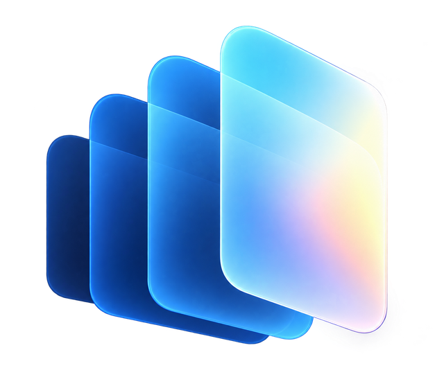
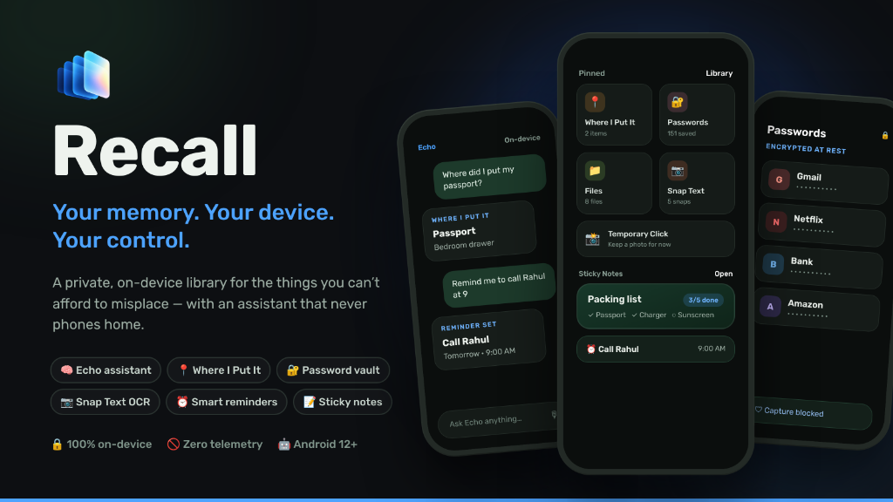
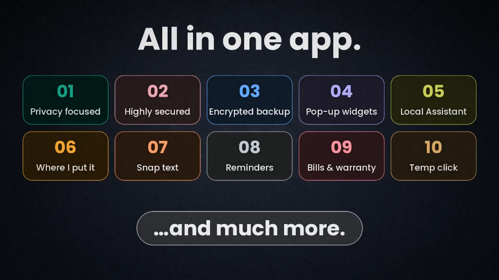

<div align="center">

  

  # Recall

  ### Your memory. Your device. Your control.

  <p align="center">
    A private, on-device library for the things you can't afford to misplace.<br />
    Notes, passwords, locations, receipts, reminders, and spending analytics — with an assistant that never phones home.
  </p>

  <p align="center">
    <a href="https://github.com/SeNsXD/Recall/releases/tag/v1.0.0"></a>
    <a href="#"></a>
    <a href="#"></a>
    <a href="#"></a>
    <a href="#"></a>
  </p>

  <p align="center">
    <a href="https://github.com/SeNsXD/Recall/releases/download/v1.0.0/Recall-v1.0.0.apk"><strong>📥 Download Latest APK (v1.0.0)</strong></a>
    &nbsp;•&nbsp;
    <a href="#-top-10-features"><strong>Top 10 Features</strong></a>
    &nbsp;•&nbsp;
    <a href="#-privacy-architecture-recall-vs-traditional-apps"><strong>Privacy Architecture</strong></a>
    &nbsp;•&nbsp;
    <a href="#-installation--setup"><strong>Installation</strong></a>
    &nbsp;•&nbsp;
    <a href="#-permissions-transparency"><strong>Permissions</strong></a>
  </p>

</div>

<br />

<div align="center">
  
</div>

<br />

## 🌟 Why Recall?

Modern apps routinely send your private thoughts, receipts, credentials, and camera captures to third-party clouds. **Recall is built on a different philosophy: radical data sovereignty.**

Everything you save in Recall lives exclusively inside your phone's encrypted sandbox. Echo, your integrated personal assistant, parses queries, matches memories, and organizes your life directly on your device CPU—without external AI APIs, account registrations, or telemetry beacons.

<br />

---

## 🏆 Top 10 Features

<div align="center">
  
</div>

<br />

<table>
  <tr>
    <td width="50%" valign="top">
      <h3>01. 🛡️ Privacy Focused</h3>
      <p>Zero telemetry, zero analytics SDKs, and zero ad networks. All your notes, photos, and records live 100% on your device in a private local database. No mandatory account, no signup, and no internet connection required for core use.</p>
    </td>
    <td width="50%" valign="top">
      <h3>02. 🔐 Highly Secured</h3>
      <p>Logins, credentials, and payment cards are protected by hardware-backed AES-256-GCM encryption in the Android Keystore. Guarded by biometric auth (fingerprint/face) and built-in screen shielding to block screenshots and recents previews.</p>
    </td>
  </tr>
  <tr>
    <td width="50%" valign="top">
      <h3>03. ☁️ Encrypted Backup</h3>
      <p>Client-side end-to-end encrypted backup. Your data is chunked and encrypted with AES-256-GCM using your personal 16-character recovery passphrase before upload to Google Drive, ensuring complete zero-knowledge cloud storage.</p>
    </td>
    <td width="50%" valign="top">
      <h3>04. 🪟 Pop-Up Widgets & Floating Bubble</h3>
      <p>Instant capture from anywhere. Features rich Home screen pop-up widgets and an opt-in floating sticky note bubble overlay that lets you jot thoughts, paste links, and check tasks over any active app without switching context.</p>
    </td>
  </tr>
  <tr>
    <td width="50%" valign="top">
      <h3>05. 🧠 Local Assistant (Echo)</h3>
      <p>A 100% on-device personal assistant. Search memories, find physical item locations, or schedule reminders using natural phrasing—operating entirely on your phone's CPU with zero external AI tokens or server latency.</p>
    </td>
    <td width="50%" valign="top">
      <h3>06. 📍 Where I Put It</h3>
      <p>Never misplace keys, passports, or tools again. Save belongings with contextual room/shelf locations, camera placement snaps, and audio voice drop notes with live waveform capture and custom titles.</p>
    </td>
  </tr>
  <tr>
    <td width="50%" valign="top">
      <h3>07. 📸 Snap Text (Offline OCR)</h3>
      <p>Extract text from paperwork, bills, and screenshots in milliseconds using on-device vision processing. Automatically recognizes phone numbers, dates, emails, and street addresses for one-tap saving.</p>
    </td>
    <td width="50%" valign="top">
      <h3>08. ⏰ Reminders & Exact Alarms</h3>
      <p>Precision time scheduling backed by Android exact alarm wakeup. High-priority reminders ring like an incoming phone call with text-to-speech announcement over the lock screen.</p>
    </td>
  </tr>
  <tr>
    <td width="50%" valign="top">
      <h3>09. 🧾 Bills & Warranty (Spending Analytics)</h3>
      <p>Track receipts with automatic total calculation, monitor product warranty countdowns, track subscription renewals, and view categorized multi-currency spending breakdown trends.</p>
    </td>
    <td width="50%" valign="top">
      <h3>10. ⏳ Temp Click (Ephemeral Drop)</h3>
      <p>A fast camera capture holding area for transient parking spots, temporary notes, or one-off receipts that automatically self-destruct after 24 hours unless explicitly preserved into your permanent Library.</p>
    </td>
  </tr>
</table>

---

## 🔒 Privacy Architecture: Recall vs. Traditional Apps

| Capability | Standard Cloud Apps (Notion, Keep, etc.) | Recall |
| :--- | :--- | :--- |
| **Data Storage** | Remote corporate cloud servers | **100% Local on-device encrypted database** |
| **Assistant Intelligence** | Remote proprietary LLMs (OpenAI, Claude) | **Local semantic rule & classification engine** |
| **Telemetry & Trackers** | Multiple tracking SDKs (Firebase, Segment, Ads) | **Zero trackers, zero analytics, zero ad SDKs** |
| **Password & Card Security** | Plaintext in app memory or cloud DB | **Hardware-backed Android Keystore (AES-256-GCM)** |
| **Screen Protection** | Vulnerable to screen recording & previews | **Hardware-shielded against screenshots & recents leaks** |
| **Cloud Backup** | Server-side unencrypted or provider-managed | **Client-side encrypted with a 16-char passphrase** |
| **Internet Requirement** | Mandatory for sync and query parsing | **Zero network required for all core features** |

---

## 📲 Installation & Setup

Recall is distributed directly via **GitHub Releases**.

### Quick Install (Android 12+)

1. **Download the APK**: Download [`Recall-v1.0.0.apk`](https://github.com/SeNsXD/Recall/releases/download/v1.0.0/Recall-v1.0.0.apk) from the [Latest Release](https://github.com/SeNsXD/Recall/releases/tag/v1.0.0).
2. **Install**: Tap the downloaded file. When prompted by Android, grant **"Install unknown apps"** for your browser or file manager.
3. **Open & Enjoy**: No account creation, email verification, or subscription required.

> [!TIP]
> **Built-In In-App Updates**: Recall includes an integrated, offline-safe GitHub release checker. When a new version is published to GitHub, Recall alerts you and lets you verify SHA-256 checksums and update directly from within the app.

### Verifying Checksum (Optional)
To verify the authenticity and integrity of your downloaded APK, run in PowerShell:
```powershell
Get-FileHash Recall-v1.0.0.apk -Algorithm SHA256
```
Compare the output against the verified hash published in the [GitHub Release Notes](https://github.com/SeNsXD/Recall/releases/tag/v1.0.0).

---

## 📱 System Requirements

* **Platform**: Android 12.0+ (API 31+)
* **Architecture**: Universal (ARM64 / ARMv7 / x86_64)
* **Internet**: Not required for core functionality
* **Google Play Services**: Optional (only for Google Drive backup)

---

## 🛡️ Permissions Transparency

Recall requests Android permissions only in context when you actively trigger features:

| Permission | Purpose | Why It's Needed |
| :--- | :--- | :--- |
| `CAMERA` | Placement photos & OCR | Only active when taking a placement snap or scanning paperwork |
| `RECORD_AUDIO` | Voice drop notes | Only active while you record a voice placement note |
| `POST_NOTIFICATIONS` | Reminders & alarms | Required on Android 13+ to deliver your scheduled reminder alerts |
| `USE_EXACT_ALARM` | Precise reminder timing | Ensures time-critical alarms fire precisely at the scheduled minute |
| `SYSTEM_ALERT_WINDOW` | Floating note bubble *(Opt-in)* | Only requested if you choose to enable the overlay sticky note bubble |
| `REQUEST_INSTALL_PACKAGES` | In-app GitHub updates | Prompts to install new verified APK updates directly from GitHub |

---

## 🤝 Community & Support

* **Bug Reports & Feature Requests**: Submit an issue via the [GitHub Issue Tracker](https://github.com/SeNsXD/Recall/issues).
* **Security Disclosures**: Please file an issue with the `security` tag or contact the repository owner directly.

---

<div align="center">
  <sub>Crafted with passion for personal freedom and software privacy. Your data belongs to you.</sub>
</div>
